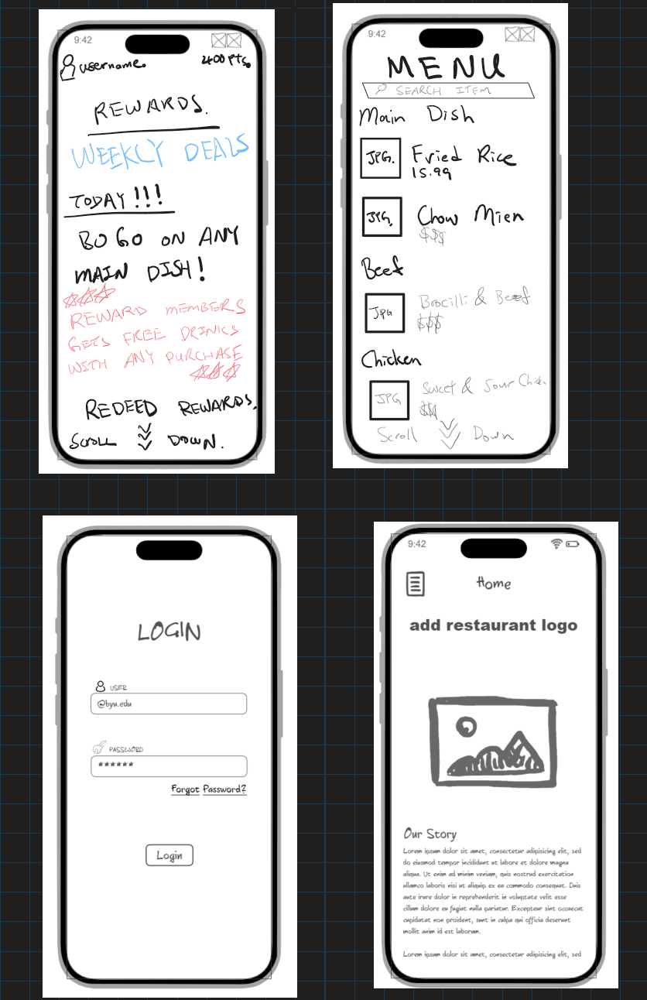

# Brothers HotPot Website

## Overview

A responsive web application built as part of BYU CS 260. The project simulates a restaurant site for **Brothers HotPot**, an authentic Chinese buffet concept. It demonstrates full-stack development with features like menu browsing, rewards tracking, authentication, and interactive media.

## Elevator Pitch

This website allows users to:

* Browse delicious menu items with images and prices
* Join a rewards program to save money on dining
* Find the restaurant via interactive maps
* View and leave reviews
* Explore an immersive photo and video gallery

## Key Features

* Display menu with embedded photos and prices
* Interactive map with directions to the restaurant
* 360° interactive panorama
* Secure login over HTTPS
* Embedded Google reviews
* Interactive photo/video gallery
* Admin panel for editing food items, prices & pictures
* Rewards program with persistent user points

## Technologies

* **Frontend:** HTML, CSS, JavaScript, React
* **Backend:** Node.js + Express
* **Database:** MongoDB Atlas
* **Realtime:** WebSocket for live updates
* **Third-party services:** Google Maps, Google Reviews

## Project Structure

```
index.html      # Main landing page
public/         # Static assets
src/            # React components and routing
server/         # Express backend services
notes.md        # Development notes and progress logs
```

## Implementation Highlights

* **Authentication:** Secure login system with user registration
* **Database:** Stores user credentials, menu items, and reward points in MongoDB
* **Service Endpoints:** Backend routes for login and rewards system
* **Frontend Integration:** Fetch API connects frontend to backend services
* **Responsive Styling:** Traditional Chinese cultural design applied with CSS

## Deliverables (BYU CS 260)

* **HTML deliverable:** Complete page structure, links, images, and placeholders for login/reviews
* **CSS deliverable:** Styled header, footer, navigation, and responsive layout
* **React deliverable:** Components for login, menu, and rewards; React Router for navigation; hooks for auth state
* **Service deliverable:** Node.js/Express server with API endpoints and integration of third-party services
* **DB/Login deliverable:** User registration and rewards points stored in MongoDB; restricted access to rewards page

## Design



> See [`notes.md`](notes.md) for development documentation and iteration details.
